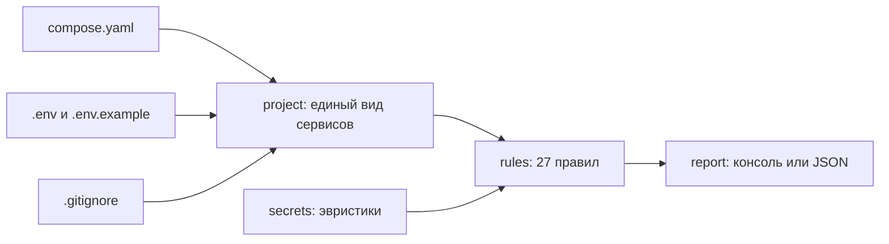

# compose-doctor — проверка compose и .env до выката

`docker compose config` отвечает на вопрос «файл синтаксически верен?». Этот инструмент отвечает на другой: «что сломается или утечёт, если это выкатить?». Двадцать семь правил: секреты открытым текстом, образы без версии, порты на всех интерфейсах, отсутствие ограничений памяти, `.env` без `.gitignore`, расхождение `.env` с примером, конфликт портов, зависимость от несуществующего сервиса.

У каждой находки есть код, уровень, причина и готовая правка — отчёт можно читать, ничего не гугля.

```text
$ doctor demo

Как обычно пишут:

Ошибки (6):
! [R04] services.web.image: образ без тега: nginx
! [S01] services.web.environment.DB_PASSWORD: секрет лежит в файле открытым текстом
! [S01] services.база.environment.POSTGRES_PASSWORD: секрет лежит в файле открытым текстом
! [S02] services.база: контейнер запускается в привилегированном режиме
! [S03] services.web: внутрь контейнера проброшен сокет Docker
! [S08] .gitignore: .env не исключён из git

Предупреждения (10):
· [M02] compose.yaml: нет примера окружения
· [R01] services.web: не задана политика перезапуска
· [R02] services.база: нет проверки здоровья, хотя от сервиса зависят другие
· [R06] services.web: нет ограничения памяти
· [R07] services.база.volumes: данные лежат в безымянном томе: /var/lib/postgresql/data
· [S06] services.web.ports: порт 80:80 открыт на всех интерфейсах
· [S10] services.web.environment.API_URL: переменная ${API_URL} нигде не описана
…

Советы (7):
→ [M01] version: устаревший ключ version
→ [R03] services.web.depends_on.база: зависимость без условия
→ [R08] services.web: жёсткое имя контейнера: shop-web
→ [S05] services.web: процесс в контейнере работает от root
…

Итого: ошибок 6, предупреждений 10, советов 7.

Как стоит:
compose.yaml: замечаний нет.

Ошибок было 6, стало 0.
```

Полный вид находки — с объяснением и правкой:

```text
! [S01] services.web.environment.DB_PASSWORD: секрет лежит в файле открытым текстом
    значение задано прямо в файле (s3***********rd); compose лежит в git — секрет уедет вместе с ним
    Как поправить: вынести значение в .env и подставить: DB_PASSWORD: ${DB_PASSWORD}
```

Само значение секрета в отчёт не попадает — только маска: иначе отчёт сам стал бы местом утечки.

## Что проверяется

| Семья | Примеры правил |
|---|---|
| `S` — безопасность | секрет открытым текстом, `privileged: true`, сокет Docker внутри контейнера, `network_mode: host`, опасные возможности, публикация порта на все интерфейсы, `.env` не в `.gitignore`, `env_file` на несуществующий файл, переменная `${VAR}`, которой нигде нет |
| `R` — надёжность выката | образ без тега или `latest`, плавающий тег, нет `restart`, нет `healthcheck` у сервиса, от которого зависят, `depends_on` без условия, нет ограничения памяти, данные в безымянном томе, конфликт портов, зависимость от несуществующего сервиса, необъявленный том или сеть |
| `M` — сопровождение | устаревший ключ `version`, нет `.env.example`, расхождение `.env` с примером, логи без ротации, сервис без `image` и без `build`, лишние объявления |

`doctor rules` печатает весь список с пояснениями.

## Как запустить

```bash
uv sync
uv run doctor check .                    # текущая папка
uv run doctor check путь/compose.yaml    # конкретный файл
uv run doctor check . --strict           # предупреждения тоже считать провалом
uv run doctor check . --short            # только строки, без объяснений
uv run doctor check . --json             # для сборки
uv run doctor check . --ignore M,R08     # отключить семью или правило
uv run doctor rules                      # что вообще проверяется
uv run doctor demo                       # один сервис в двух видах: как обычно и как стоит
```

Коды возврата: `0` — ошибок нет, `1` — есть ошибки (или, с `--strict`, предупреждения), `2` — файл не прочитать. Этого достаточно, чтобы поставить проверку в сборку:

```yaml
- name: Проверить compose
  run: uv run doctor check . --strict
```

В `examples/` лежит образцовый compose: `doctor check examples` не выдаёт ни одного замечания, и это проверяется тестом — образец не может устареть незаметно.

## Как устроено



| Модуль | Ответственность |
|---|---|
| `project.py` | разбор compose: порты, тома, переменные и зависимости в любой из допустимых записей |
| `env.py` | чтение `.env`, поиск подстановок `${VAR}`, распознавание заглушек, маскирование значений |
| `secrets.py` | эвристики «это похоже на настоящий секрет, а не на подстановку» |
| `rules.py` | 27 правил, каждое — небольшая функция с кодом, уровнем и объяснением |
| `report.py`, `cli.py`, `demo.py` | отчёт, команды, демонстрация |

## Что показала проверка на настоящих файлах

Проверка шла на compose-файлах из открытых домашних инфраструктур на GitHub (`mortennordbye/homelab`, `HYP3R00T/homelab`) — это не учебные примеры, а рабочие конфигурации. `docker compose config` считает оба правильными (код возврата 0), то есть находки ниже — не про синтаксис.

```text
$ doctor check HYP3R00T_homelab/gitops/apps/lab/homepage --short
Предупреждения (2):
· [R01] services.homepage: не задана политика перезапуска
· [R06] services.homepage: нет ограничения памяти
Советы (3):
→ [M04] services.homepage: логи не ограничены
→ [R08] services.homepage: жёсткое имя контейнера: homelab-homepage-preview
→ [S05] services.homepage: процесс в контейнере работает от root
Итого: ошибок 0, предупреждений 2, советов 3.

$ doctor check mortennordbye_homelab/portfolio --short
Предупреждения (5):
· [R01] services.cv-bundle: не задана политика перезапуска
· [R01] services.dev: не задана политика перезапуска
· [R02] services.cv-bundle: нет проверки здоровья, хотя от сервиса зависят другие
· [R06] services.dev: нет ограничения памяти
· [S06] services.dev.ports: порт 3000:3000 открыт на всех интерфейсах
Советы (4):
→ [M04] services.dev: логи не ограничены
→ [R08] services.cv-bundle: жёсткое имя контейнера: portfolio-cv-bundle
→ [R08] services.dev: жёсткое имя контейнера: portfolio-dev
→ [S05] services.dev: процесс в контейнере работает от root
Итого: ошибок 0, предупреждений 5, советов 4.
```

Ошибок нет ни в одном — это хорошие файлы. Замечания честные и в основном справедливые: у обоих сервисов нет политики перезапуска и ограничения памяти, а `3000:3000` в файле для разработки открывает порт на все интерфейсы машины. При этом часть находок — про среду разработки, где они допустимы: для таких случаев есть `--ignore`.

## Как проверялось

- `ruff format`, `ruff check` (E, F, W, I, B, UP, S — bandit, C4, SIM, PT, RUF, DTZ) и `mypy --strict` — без замечаний.
- `pytest` — 78 тестов за 0,4 с: разбор портов и томов во всех допустимых записях, переменные списком и словарём, зависимости обеих форм, ограничения из `deploy` и из старых ключей, шесть видов испорченных файлов, эвристики секретов, каждое правило по отдельности, фильтры `--only`/`--ignore`, коды возврата и JSON.
- Отдельный тест проверяет образец из `examples/`: если он перестанет быть образцовым, сборка об этом скажет.
- **Живой прогон нашёл ошибку разбора.** На настоящем файле `mortennordbye/homelab` инструмент упал: том `.:/app` он принял за букву диска Windows (`C:\data`) и отказался разбирать. Теперь буквой диска считается только одиночная латинская буква, а на этот случай есть тест.
- Результаты сверены с `docker compose config`: оба файла он считает верными, значит, мои находки — про смысл, а не про синтаксис. На собственном примере с несуществующим сервисом docker выдаёт ту же ошибку, что и правило R10.

### Не проверялось

- Только формат Compose Spec. Манифесты Kubernetes, Helm-чарты и Terraform этот инструмент не читает.
- Проверка статическая: контейнеры не запускались (демон Docker на машине не поднят), образы не скачивались, существование тегов не проверялось.
- Эвристика секретов ищет по имени переменной и по виду значения. Пароль в переменной с именем `VALUE` она пропустит, а длинный неслучайный идентификатор может принять за ключ — поэтому S01 показывает маску и объяснение, а не просто «утечка».
- `include`, `extends`, профили и несколько файлов через `-f` не поддерживаются: проверяется один файл.
- На большом репозитории с сотней compose-файлов инструмент не гонялся, времени работы на таком объёме я не измерял.
- Правила отражают распространённые практики, а не стандарт: в среде разработки половина предупреждений допустима, и для этого есть `--ignore`.

## Структура

```text
src/doctor/  project, env, secrets, rules, findings, report, cli, demo
tests/       разбор, окружение, секреты, все правила, командная строка
examples/    образцовый compose и .env.example — проверка на них молчит
```
